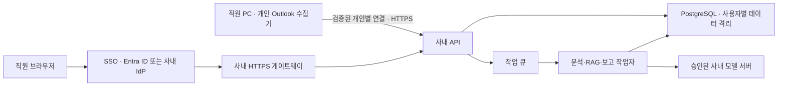

# 메일 브레인 사내 배포 가이드

작성 기준: 2026-11-05. 현재 Python 소스와 공식 문서를 확인한 전환 계획입니다. 사내 서버·SSO·메일 권한·실제 모델은 연결하거나 변경하지 않았습니다.

## 권장 경로

지금은 **각 직원 PC에서 실행하는 로컬 앱을 소규모로 배포**하는 경로가 현실적입니다. 개인 Outlook 프로필을 재사용하고 원문을 PC에 보관할 수 있습니다. 이후 운영 필요가 확인되면 **개인 PC 수집기 + SSO 중앙 웹앱**으로 확장합니다. 메일 서버 직접 연동 승인이 나면 수집기를 Microsoft Graph로 교체할 수 있습니다.

| 배포 방식 | 현재 구조 재사용 | 장점 | 필요한 추가 작업 |
|---|---|---|---|
| 직원별 로컬 앱 | 높음 | 서버 메일 권한 없이 개인 Outlook 사용, 원문 PC 보관 | 사용자별 데이터 폴더, 설치·업데이트 패키지, PC 보안·지원 |
| PC 수집기 + 중앙 웹앱 | 수집기 재사용 | 브라우저 공통 화면과 중앙 운영 | SSO, 전송 API, 사용자 격리 DB/RAG/보고서, HTTPS, 수집기 등록 |
| Graph + 중앙 웹앱 | UI·분석 로직 중심 | PC가 꺼져도 서버 작업 구성 가능 | Microsoft 365/Exchange 환경 확인, 앱 등록·동의, 토큰 보관, 증분 동기화 |

사내 AD 계정이라는 사실만으로 Graph를 사용할 수 있는 것은 아닙니다. 회사 메일이 Exchange Online인지, 온프레미스 Exchange인지, 별도 그룹웨어인지 먼저 확인해야 합니다. 사용자의 기존 우려처럼 타 사서함 접근이 문제라면 PC 수집기를 유지하거나 로그인 사용자의 `/me` 범위로 설계한 위임 권한부터 검토합니다.

## Microsoft Teams 탭으로 가져오기 가능성

가능합니다. 현재 UI는 웹 화면이므로 개인 탭 Teams 앱 패키지(`manifest.json`과 아이콘)를 만들어 업로드할 수 있습니다. 다만 Teams 탭은 매니페스트의 `contentUrl` 웹 페이지를 iframe으로 표시하고 HTTPS 주소 및 허용 도메인이 필요합니다. 이 앱은 `127.0.0.1` 전용 서버, 로컬 SQLite, Classic Outlook COM에 의존하므로 Teams 앱 ZIP만 추가해 조직에서 바로 쓸 수 있는 상태는 아닙니다.

현실적인 1차 방안은 직원 PC의 앱을 HTTPS 내부 게이트웨이 뒤에 올려 본인 PC에서 접속하는 개인 탭으로 연결하는 것이지만, 지금의 로컬 전용 서버와 공통 토큰은 이 용도로 공개하면 안 됩니다. 운영 가능한 Teams 탭에는 사용자별 SSO/인증, HTTPS, iframe 허용 헤더, API 권한 검증과 사용자별 데이터 격리가 선행되어야 합니다. 메일 수집을 서버에서 하려면 Outlook COM 대신 Microsoft Graph 위임 권한과 회사 테넌트의 앱 동의도 필요합니다. 앱의 조직 업로드 역시 Teams 관리자가 사용자 지정 앱 업로드를 허용하거나 앱을 승인해야 할 수 있습니다.

따라서 **개인 PC에서만 보는 탭은 UI 연결 수준으로 구현 가능**, **조직 공용 업무 앱은 인증·호스팅·메일 수집 구조를 추가 개발한 뒤 가능**으로 판단합니다. 참고: [Teams 개인 탭 만들기](https://learn.microsoft.com/en-us/microsoftteams/platform/tabs/how-to/create-personal-tab), [Teams 사용자 지정 앱 업로드](https://learn.microsoft.com/en-us/microsoftteams/platform/concepts/deploy-and-publish/apps-upload), [Graph 메일 목록 권한](https://learn.microsoft.com/en-us/graph/api/user-list-messages?view=graph-rest-1.0).

## 현재 코드를 그대로 공용 서버에 올릴 수 없는 이유

`mailbrain/web.py`는 loopback 전용 Python `http.server`와 앱 시작 시 발급하는 공통 토큰을 사용합니다. 이 토큰은 로컬 요청 방어용이며 사원 로그인이나 사용자별 권한이 아닙니다. Python도 해당 서버를 운영 환경용으로 권장하지 않습니다. [Python 공식 문서](https://docs.python.org/3/library/http.server.html)

`load_config`의 Windows 사용자명 조합은 본인 주소를 찾는 보조 기능입니다. 중앙 서버에서 실행하면 접속한 사원이 아니라 서버 실행 계정을 읽습니다. 신원은 SSO가 검증한 사용자 식별자에서 가져와야 합니다.

Outlook COM 수집은 사용자 로그인 세션과 Classic Outlook 프로필을 필요로 합니다. 이를 Windows 서비스나 서버 공용 계정으로 옮기는 설계는 권하지 않습니다. Microsoft는 비대화형 서버에서 Office 자동화를 권장하거나 지원하지 않습니다. [Microsoft 공식 안내](https://support.microsoft.com/en-gb/visio/considerations-for-server-side-automation-of-office)

현재 `Store.bind_owner`는 폴더 하나를 계정 하나에 묶습니다. 공용 서버의 여러 사용자를 격리하는 행 단위 권한 기능은 아닙니다. 포트를 `0.0.0.0`으로 바꾸거나 프록시만 붙여서 공용 서비스로 공개하지 마세요.

## 1단계: 로컬 앱 파일 배포

1. 파일럿용 소스 릴리스를 고정하고 자동 테스트를 실행합니다. 업무망 Windows와 Classic Outlook에서 수집·본문 보기·기간 지정·복원·보고서를 확인합니다. 새 Outlook 지원 여부는 별도 검증 대상입니다.
2. 배포물에 코드·`static`·`prompts`·`main_prompt`·설정 예시·실행 도우미만 포함합니다. 개발자의 `config.json`, `data`, `backups`, `output`, `tmp`, 가상환경, 브라우저 프로필과 개인 메일을 포함하지 않습니다. 개인 정보가 포함될 수 있는 README의 실계정 사례도 배포용 문서에서 제거합니다.
3. `%LOCALAPPDATA%\MailBrain\data` 아래에 사용자별 DB를 두도록 설치 시 설정을 만듭니다. 회사 PC가 여러 Windows 계정을 지원하면 코드 설치 경로는 공통으로 두고 데이터·설정·브라우저 세션은 사용자별로 분리합니다. `data_dir`은 절대 경로를 사용할 수 있지만 설정 경로는 설치 도우미에서 지정해야 합니다.
4. 현재 `run.bat`은 프로젝트 폴더의 `config.json`을 사용합니다. 관리자가 쓰기 제한한 Program Files에 배포할 경우 그대로 사용하지 말고 `%LOCALAPPDATA%`의 설정을 `app.py --config <설정 경로> serve --open-browser`로 넘기는 실행 도우미를 만듭니다.
5. 승인된 Python과 의존성을 사내 저장소에서 설치하거나 사내 승인 빌드 도구로 실행 패키지를 만듭니다. 코드 서명, 설치 해시, 버전, 롤백본을 배포 담당자가 관리합니다. 현재 프로젝트에는 MSI/자동 업데이트 구현이 없습니다.
6. 자동 시작이 필요하면 **사용자 로그인 후** 실행되는 작업으로 등록합니다. 이 가이드는 작업을 등록하지 않았습니다. 앱이 꺼지거나 PC가 절전이면 자동 수집은 멈춥니다.
7. 디스크 암호화와 사용자 폴더 ACL, 회사가 정한 보존 기간·백업 정책을 적용합니다. SQLite를 백업할 때는 앱을 멈추거나 SQLite backup API로 일관된 스냅샷을 만듭니다. DB 파일만 사용 중에 복사하면 WAL의 최신 변경이 빠질 수 있습니다.

현재 `run.bat`의 중복 실행 재사용과 빈 포트 선택 기능은 각 PC의 사용 편의를 위한 것입니다. 같은 앱인지 `/healthz`의 지문으로 확인하고, 다른 프로세스는 종료하지 않습니다. 이전 코드 버전이 이미 실행 중이면 새 포트를 사용할 수 있으므로 업데이트 시 기존 앱을 종료하고 다시 실행하는 절차를 안내해야 합니다.

## 2단계: 중앙 웹앱 구현

위 그림은 구축 목표입니다. 현재 소스에 구현된 중앙 서비스가 아닙니다.

| 영역 | 추가 구현·운영 작업 | 완료 기준 |
|---|---|---|
| 인증 | Entra ID/사내 IdP OIDC 또는 사내 SSO, 세션 수명·로그아웃·재인증 | A 계정으로 로그인한 요청이 항상 A로 식별됨 |
| API | FastAPI 등 운영용 Python 앱과 운영 ASGI 서버, 중앙 설정·예외 처리 | 장시간 분석은 작업 ID 반환, 상태 조회·취소·재시도 가능 |
| 사용자 격리 | 모든 메일·업무·후보·이벤트·솔루션·보고서·검색 청크에 user_id, 필요 시 tenant_id | ID를 바꾼 직접 API 요청과 RAG 검색에서도 B의 원문·요약·근거가 A에게 나오지 않음 |
| 수집기 인증 | 로그인 사용자와 장치 등록을 묶고 서버에서 소유자를 확정 | 요청 본문에 넣은 다른 이메일로 수집 대상을 바꿀 수 없음 |
| 저장 | PostgreSQL 등 동시 사용 DB, 마이그레이션, 암호화된 보고서 저장소 | 동시 승인·중복 메일·재시작에 일관성 유지, 복원 시연 |
| 검색/RAG | 검색 전 user_id 강제 필터, 토픽 확장·인용·캐시에도 동일한 경계 | 사용자별 격리 자동 테스트 통과 |
| 네트워크 | 사내 DNS·TLS 인증서·HTTPS 리버스 프록시, 방화벽에서 앱 직접 접근 차단 | 외부망 공개 없이 회사가 지정한 경로로만 접근 |
| 모델 | 승인된 내부 엔드포인트, 작업별 사용자 정보·근거 제한, 입력·출력 상한, 시간 제한 | 원문 로그 미출력, 부하·품질·실패 시 동작 확인 |
| 운영 | 지표·오류 알림, 내용 없는 감사 로그, 백업·복원·보존·계정 퇴사 처리 | 담당자와 장애 대응·복구 목표가 문서화됨 |

현재 로컬 모델 주소 `127.0.0.1:11434`는 코드에 고정되어 있습니다. 중앙 모델 서버를 쓰려면 엔드포인트 설정화, 인증, TLS 검증, 서버측 허용 주소 목록을 새로 구현해야 합니다. 현재 기능이 원격 모델을 이미 지원한다고 가정하지 마세요.

PC에서 무엇을 보낼지도 먼저 결정해야 합니다. 원문을 PC에 남기고 요약·업무만 중앙에 보내면 중앙 검색의 근거 범위가 제한됩니다. 원문까지 보내면 중앙 본문 보기와 RAG는 쉬워지지만 회사의 전송·보존 기준에 맞는 접근 통제와 저장이 필요합니다. 현재 변경은 어느 방식으로도 회사 메일을 전송하지 않습니다.

## 3단계: 메일 서버 연동을 승인받은 경우

Exchange Online/Microsoft 365 지원이 확인되면 로그인 사용자의 **위임 권한 `Mail.Read`**와 `/me` 엔드포인트를 우선 검토합니다. 본문을 읽으려면 `Mail.ReadBasic`만으로는 부족합니다. 처음부터 전체 사서함을 읽을 수 있는 앱 전용 권한이나 `Mail.ReadWrite`·`Mail.Send`를 요구할 이유는 없습니다. 실제 동의 가능 범위는 회사 테넌트 정책에 따릅니다. [Microsoft Graph 권한 문서](https://learn.microsoft.com/en-us/graph/permissions-reference)

수집 범위는 기존 원칙대로 처음 최근 30일, 과거는 명시한 기간입니다. 이후에는 폴더별 delta 상태를 저장해 변경분을 동기화하는 구현을 검토합니다. delta는 폴더 단위이고 반환된 nextLink/deltaLink를 따라가야 합니다. 필터 지원·토큰 만료·폴더 이동을 테스트하고 재동기화 정책을 둡니다. [Microsoft Graph 증분 동기화](https://learn.microsoft.com/en-us/graph/delta-query-messages)

Graph가 불가능한 그룹웨어라면 공급사의 개인 범위 읽기 API나 승인된 PC 수집기를 검토합니다. 서버 승인이 거절되었다는 이유로 인증·권한 제한을 우회하는 스크래핑을 중앙 서버에서 운영하지 않습니다. 현재 그룹웨어 수집기도 실제 사이트의 본인 계정 표시와 DOM 구조 확인이 필요한 상태입니다.

## 담당자에게 확인할 항목과 전환 순서

먼저 IT·메일 담당자에게 메일 플랫폼 종류, Classic Outlook 배포 상태, 사내 SSO 방식, 개인 읽기 권한 허용 여부를 확인합니다. 보안 담당자와는 메일 본문 중앙 저장 가능 여부, 사내 모델 사용, 보존·파기 기간을 정합니다. 인프라 담당자는 서버·DNS·인증서·DB·백업·운영 담당자를 확정합니다.

진행 순서는 **소규모 로컬 파일럿 → 계정 격리와 SSO 설계 → 중앙 API·DB·작업 큐 → 사용자별 데이터 이전 → 통합·부하·권한 검증 → 제한된 조직 시범 운영 → 확대**를 권합니다. 규모와 회사 인프라가 확인되지 않아 임의의 서버 용량·인원·일정은 확정하지 않았습니다.

출시 전에는 두 계정 간 원문·보고서·솔루션 캐시·검색 근거의 상호 접근 차단, 중복 수집, 완료·재개·삭제·복원 이력, Teams 제외, 모델 실패, PC 오프라인·재접속, 백업 복원을 시연합니다. 현재 테스트 통과는 로컬 앱의 검증이며 중앙 배포 검증을 대체하지 않습니다.
