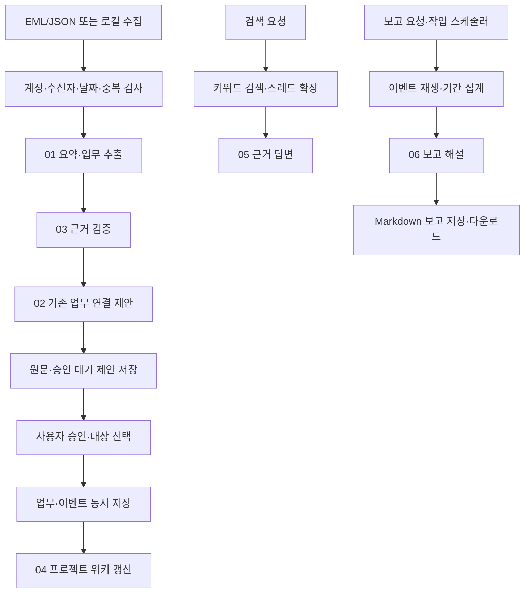

# 프로그램 설계와 업무 흐름

## 토픽·RAG·PDF 업데이트

`topics.py`가 ConversationID와 정규화한 제목으로 토픽 읽기 모델을 만듭니다. 원문·후보를 삭제하지 않고 최신 수신일순 요약과 지연 로딩 하위 항목을 제공합니다. 기존 DB에는 `received_at`과 보고서 `document` 컬럼만 추가합니다.

`rag.py`는 메일의 새 본문과 업무 이벤트를 청크로 나눠 SQLite FTS5에 색인하고 BM25·동의어·토픽 확장으로 검색합니다. 기간·토픽 경계는 확장에도 적용하며, 결과는 일자별 근거와 추출형 답변으로 제공합니다. Ollama 설정 시 `07_history` 역할로 생성하고 인용 ID를 검사합니다. 신경망 임베딩은 사용하지 않습니다.

`reporting.py`는 참조 PDF의 구분·금주·차주·비고 구조를 화면·Markdown·PDF로 제공합니다. 전체 메일 원문은 유지하고 보고에는 분류별 최신 토픽 요약과 검증된 업무 상태를 사용합니다. 표시 제한과 제외 조건은 [업데이트 안내](토픽_RAG_업데이트.md)에 명시했습니다. 변경 전 복원점은 `backups/v0.1`입니다.

## Outlook 실제 연동 업데이트 — 2026-11-04

- Windows 환경의 USERNAME과 `golfzon.com`을 조합해 본인 주소를 계산합니다. 실제 인증은 로그인된 Classic Outlook 프로필에 맡깁니다.
- `mailbrain/sync.py`의 전용 STA 작업 스레드에서 COM을 초기화하고 조회합니다. HTTP 화면은 수집 중에도 응답합니다.
- 앱 시작 시와 기본 10분 간격으로 최근 30일을 수집합니다. 자동 수집은 앱 실행 중에만 동작합니다.
- 수신 시각의 UTC DASL Restrict 필터를 먼저 적용합니다. 지정 기간 밖이나 이미 저장된 메시지 ID는 본문을 읽지 않습니다.
- 과거 수집은 화면의 기간 지정 또는 CLI의 `--start`, `--end`로 제한합니다. 공유 사서함과 하위 폴더는 순회하지 않습니다.
- 기본 설정은 `data/golfzon`, 실습 설정은 `config.demo.json`과 `data/demo`로 분리합니다.
- 실제 연결과 최근 30일 409건 수집, 자동 재수집에서 추가 저장 0건을 확인했습니다.
- 긴 메일의 규칙 기반 업무 후보는 중복 제거 후 30개까지만 추출하고 요약에 제한 사실을 표시합니다. 메일 원문은 보존합니다.
- 웹 서버는 같은 포트에 중복 실행되지 않게 구성했습니다. 포트 사용 중이면 이전 앱을 종료하고 다시 실행합니다.

## 구조

```text
app.py                         명령행 진입점
run.bat                        Windows 실행 도우미
config.example.json            설정 예시
main_prompt                    역할 조정 지침
prompts/                       공통·업무 역할 6개·개발 역할 3개
mailbrain/core.py              저장·분석·승인·검색·위키·보고
mailbrain/collectors.py         EML/JSON·Outlook·브라우저 수집
mailbrain/web.py               로컬 HTTP API
mailbrain/demo.py              가상 메일
mailbrain/sync.py              Outlook 백그라운드 자동 수집
static/app.css                 개편한 화면 스타일
static/app.js                  화면 상호작용·수집 상태 갱신
static/index.html              한국어 업무 화면
tests/                         자동 테스트
data/                          사용자 데이터, Git 제외
```

## 메일 처리 흐름



## 데이터 모델

| 테이블 | 내용 | 규칙 |
|---|---|---|
| messages | ID, 스레드, 수신 정보, 발송일, 원문, 요약, 분석 결과 | ID 고유, 원문 갱신 API 없음 |
| proposals | 신규·변경·취소·완료 제안, 대상 업무, 근거 원문 | 승인 또는 제외까지 대기 |
| tasks | 현재 업무명·프로젝트·담당자·기한·상태 | 사용자 승인/수정으로 변경 |
| events | 업무 변경 전후 스냅샷, 주체, 근거, 시각 | 업무 변경과 동일 트랜잭션, 추가 방식 |
| runs | 실행 ID·시작/종료·상태·역할·프롬프트 해시·오류 | 메일 처리·검색·보고를 기록 |
| reports | 기간·기준 시각·보고 내용 | 재생성하면 새 버전으로 보관 |

위키는 `data/wiki/projects.md`, 보고서 사본은 `data/reports/`에 생성됩니다. 메일 원문은 SQLite의 messages.body에 보관되며 EML 첨부·원본 바이트 전체를 별도 보존하는 기능은 없습니다. EML 원본 파일은 사용자가 보존해야 합니다.

## 승인과 상태 변경

- CREATE 승인: 신규 업무 생성. 기존 대상을 선택하면 해당 업무의 필드를 갱신합니다.
- UPDATE 승인: 대상 업무가 필요합니다. 새 업무로 조용히 바꾸지 않습니다.
- CANCEL/COMPLETE 승인: 대상 업무를 취소/완료 처리합니다.
- 제외: 제안만 제외하고 업무를 바꾸지 않습니다.
- 사용자 직접 변경: 상태·기한을 바꾸고 사용자 이벤트를 남깁니다.
- 사용자 수정 여부와 무관하게 이후 메일 변경은 다시 제안으로 제시합니다. 자동 덮어쓰기는 없습니다.

동일 메일 ID를 다시 읽으면 중복입니다. 동일 ID인데 본문이 다르면 충돌 오류로 처리합니다. 서로 다른 메일의 동일 요청은 자동 중복 업무로 확정하지 않으며 사용자가 기존 대상을 선택해야 합니다.

현재 업무 연결 후보는 같은 스레드에서 찾습니다. 다른 스레드로 온 변경은 확인함에서 직접 대상을 선택할 수 있습니다. 스레드 간 자동 의미 연결은 이후 확장입니다.

## 모델 모드

`rules`: 외부 모델 호출 없음. ISO 날짜와 `업무: 산출물;` 패턴, 요청·변경·취소·완료 표현을 이용합니다. 한 줄에 복수 담당자나 복잡한 문장이 있으면 오분류할 수 있습니다.

실제 메일의 자유 형식 문맥을 정밀하게 해석하는 모델이 아니므로, 규칙 기반 제안은 사용자 검토가 필요합니다. 요청이 많은 회신에서는 원문 확인을 병행합니다.

`ollama`: 로컬 `http://127.0.0.1:11434/api/chat`만 호출합니다. 운영체제 HTTP 프록시는 사용하지 않습니다. 추출·검증·연결·위키·검색·보고 역할을 각 단계에서 호출합니다. 자동 반복 호출은 없고 각 입력은 최대 120KB입니다. 모델 접속 장애는 오류로 표시합니다. 자유 형식 메일의 품질은 선택한 모델과 원문 형식에 따라 달라집니다.

분석 JSON의 기본 스키마, 날짜, 원문 근거 문구는 코드로 검사합니다. LLM 검증 PASS도 정확도를 보장하지 않으므로 업무 변경은 사용자 승인을 거칩니다. 위키·검색·보고의 AI 해설은 별도로 표시하며, 생성 문장 전체의 자동 사실 검증은 구현하지 않았습니다.

## 보고 기준

기간은 KST 날짜이고 종료일은 오늘까지입니다. 이벤트 시각을 기준으로 기간 종료일까지의 상태를 재생합니다. 기간 내 완료 전이가 있고 종료 시점에도 완료 상태인 업무를 완료 건수로 한 번 집계합니다. 재개된 업무는 완료에서 제외합니다. 이전에 생성된 미완료 업무도 이월 목록에 포함됩니다.

메일을 과거 날짜로 가져와도 업무가 오늘 승인됐다면 오늘의 업무 이벤트입니다. 메일 발송일을 실적일로 소급하지 않습니다. 결과는 당시 앱에 기록된 사실에 한정됩니다.

## 실행과 보호 경계

- 단일 사용자·단일 PC용 HTTPServer. 127.0.0.1 바인딩, 호스트 검사, API 토큰, Origin 검사.
- 메일과 AI 내용은 HTML로 실행하지 않고 화면 텍스트로 이스케이프합니다.
- 브라우저 수집 계정 표시와 설정 주소가 정확히 일치하지 않으면 중단합니다.
- 로그인·MFA는 사용자가 직접 수행합니다. 인증 우회와 다른 사서함 탐색 기능은 없습니다.
- 데이터베이스와 브라우저 프로필은 OS 계정 보호에 의존합니다. 앱 자체 저장 암호화는 없습니다.
- 데이터 폴더는 최초 사용자 이메일과 연결됩니다. 설정에서 다른 계정으로 바꾸면 같은 데이터 폴더를 재사용할 수 없습니다.
- AI 호출 중에는 단일 서버의 다른 화면 요청이 지연될 수 있습니다. 대규모 작업 큐와 동시 사용자 지원은 후속 과제입니다.
- 위키 생성 실패가 승인된 업무 DB 트랜잭션을 되돌리지는 않습니다. `app.py wiki`로 파생 위키를 재생성합니다.

## 이후 확장

실제 그룹웨어 DOM 확정 → 날짜별 증분 수집/페이지 이동 → 첨부문서 추출 → 업무별 권한 → 키워드+벡터 검색 → 의존관계 그래프 순서로 확장합니다. GraphRAG와 pstack/gstack 자체 설치·실행은 현재 구현에 포함하지 않습니다.
