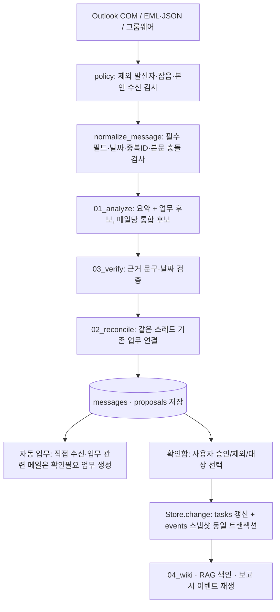

# 메일 브레인 프로그램 분석 (추가 개발 준비용)

분석 기준: 2026-11-09, 커밋 `835be47`(v.6). 전체 unittest 112개 통과. 실제 메일·`config.json`·`data/`는 열람하지 않았습니다.

## 1. 한눈에 보기

| 항목 | 내용 |
|---|---|
| 목적 | 본인 회사 메일을 로컬에서 수집·요약하고, 업무 후보 → 사용자 승인 → 상태·이력·검색·주간보고까지 관리 |
| 실행 형태 | Windows 단일 사용자 로컬 웹앱 (`127.0.0.1:18765`, 실습은 `18766`) |
| 언어·런타임 | Python 3.11+ (`.venv311`), 표준 라이브러리 HTTP 서버 + SQLite(FTS5) |
| 외부 의존성 | `pywin32`(Outlook COM), `reportlab`(PDF). 선택: `playwright`(그룹웨어 브라우저 수집) |
| 프런트엔드 | 프레임워크·번들러 없는 순수 JS 4개 파일 + CSS + `index.html` |
| AI | 기본 `engine=rules`(결정 규칙, LLM 호출 없음). 선택 `engine=ollama`(로컬 `127.0.0.1:11434`만) |
| 코드 규모 | Python 약 2,550줄(이 중 `core.py` 954줄·62KB), JS 약 240줄(줄이 매우 긴 압축 스타일), 테스트 7개 모듈 112개 |

## 2. 디렉터리와 모듈 책임

```text
app.py                CLI 진입점 (serve/demo/import/collect/outlook-status/search/report/wiki)
main_prompt           역할 조정 메인 프롬프트 (모든 역할 호출 시 앞에 붙음)
prompts/              common.md + 업무 역할 01~07 + 개발 역할 dev_*
mailbrain/
  core.py             설정 로드, Store(스키마·마이그레이션·업무 변경), Engine(프롬프트·Ollama), Pipeline(수집 파이프라인·검색·위키·보고)
  policy.py           수집 제외 발신자, 광고/잡음 메일, 결재 메일, 직접 수신 여부, 회신 요청, 업무 관련성 판정
  collectors.py       EML/JSON 읽기, Classic Outlook COM 수집(받은편지함 6·보낸편지함 5), 새 메일 이벤트, 그룹웨어 Playwright 어댑터
  sync.py             SyncManager: STA 전용 스레드에서 COM 초기화, 시작 시 30일 수집 + 주기 수집 + 새 메일 이벤트 수집
  topics.py           ConversationID·정규화 제목으로 토픽 묶기, 카테고리 분류, 업무 제목 생성
  rag.py              메일 새 본문·업무 이벤트 청크 → FTS5 BM25 + 동의어 + 토픽 확장, 일자별 근거/답변
  solutions.py        업무/토픽별 해결 방안(규칙 가이드 또는 Ollama), 입력 지문 캐시(solutions 테이블)
  reporting.py        주간보고(구분·금주·차주·비고 4열, 7개 구분) Markdown/PDF
  web.py              로컬 HTTP API·정적 파일 서빙, 보안 검사
  launcher.py         중복 실행 감지(/healthz 지문) 및 빈 포트 선택
  demo.py             가상 메일 5건
static/               index.html, app.js(탭·공통), tasks.js(내 업무), topics.js(토픽·확인함), solutions.js(해결 방안·회신초안)
tests/                unittest (pipeline, outlook, web, launcher, solutions, task_management, topics_history)
setup.bat / run.bat   venv311 생성·의존성 설치 / 설정 확인 후 serve --open-browser
MailBrain_OneClick.bat  zip payload를 내장한 단일 파일 설치·실행기 (%LOCALAPPDATA%\MailBrain)
```

## 3. 핵심 처리 흐름



- **승인 원칙**: 메일은 `proposals`만 만듭니다. 업무 상태 변경은 사용자 승인(`Store.resolve`) 또는 직접 수정(`edit_task`)으로만 일어납니다. 이후 메일이 사용자 수정을 자동으로 덮어쓰지 않습니다.
- **자동 업무(v.4~)**: 본인이 직접 수신한 업무성 메일은 승인 전에도 `auto_generated=1` 확인필요 업무로 "내 업무"에 노출됩니다(`create_auto_task`, `refresh_auto_thread`). 같은 스레드에 새 메일이 오면 다시 미확인으로 표시합니다.
- **이벤트 소싱**: 보고서는 `events`를 기간 종료 시점까지 재생해 상태를 복원합니다. tasks를 직접 UPDATE하는 코드는 이벤트 누락을 만듭니다. 반드시 `Store.change`를 사용하세요.
- **시작 시 정리 작업**: `Store` 생성 시 스키마 마이그레이션(`ALTER TABLE ADD COLUMN`) 후 `apply_message_policy`, `backfill_auto_tasks`, `compact_pending_proposals`, `archive_superseded_proposals`, `archive_generic_proposals`가 기존 데이터를 비파괴적으로 정리합니다(상태값만 `통합됨`·`이전 메일`·`불필요`로 변경, 삭제 없음).

## 4. 데이터 모델 (SQLite, `data_dir/mailbrain.db` 계열)

| 테이블 | 주요 내용 |
|---|---|
| messages | 원문, 요약, analysis JSON, thread_id, received_at, direction(inbound/outbound), excluded |
| proposals | CREATE/UPDATE/CANCEL/COMPLETE 후보, 대상 업무, 근거, 상태(대기·승인·제외·통합됨·이전 메일·불필요) |
| tasks | 제목·프로젝트·담당·기한·상태, completed_at, deleted_at(휴지통), summary, auto_generated, read_at, needs_reply |
| events | 업무 변경 전후 스냅샷·주체·근거·시각 (추가 전용) |
| runs | 실행 ID·상태·역할·프롬프트 SHA-256 |
| reports | 기간별 보고 버전, document 구조 |
| metadata | 데이터 폴더 소유자 이메일 바인딩 등 |
| rag_chunks / rag_fts | RAG 청크와 FTS5 색인 |
| solutions | 해결 방안 캐시(입력 지문 기준) |

업무 상태: 미등록 · 등록완료 · 진행중 · 대기 · 완료 · 취소 (`canonical_status`가 구 상태값 할일/확인필요를 변환).

## 5. HTTP API (`mailbrain/web.py`)

- GET: `/healthz`, `/`, 정적 파일(`/app.css`, `/app.js`, `/topics.js`, `/tasks.js`, `/solutions.js`), `/api/state`, `/api/sync`, `/api/tasks`, `/api/topic`, `/api/message`, `/api/report-file`
- POST: `/api/demo`, `/api/sync`, `/api/outlook/probe`, `/api/import`, `/api/task`, `/api/task/read`, `/api/task/delete`, `/api/task/restore`, `/api/resolve`, `/api/reply-draft`, `/api/solution`, `/api/search`, `/api/history`, `/api/report`
- 보안: 127.0.0.1 바인딩, Host 헤더 검사, `index.html`에 주입되는 CSRF 토큰, Origin 검사, CSP·nosniff, 액세스 로그 미출력.
- 라우팅은 `if path == ...` 연쇄입니다. 정적 JS를 새로 추가하면 GET 라우트도 추가해야 합니다.

## 6. 실행·운영 특성

- `load_config`: `identity_mode=windows_ad`면 `USERNAME@email_domain`으로 본인 주소 결정. `data_dir`는 최초 소유자에 바인딩되어 다른 계정 재사용을 거부합니다.
- `launcher`: 설정과 소스·프롬프트·정적 파일 해시가 같은 앱이 실행 중이면 재사용. 코드를 수정하면 지문이 바뀌어 새 인스턴스가 다음 빈 포트(최대 +19)에서 뜹니다. **개발 중에는 이전 서버를 Ctrl+C로 종료**해야 포트가 늘어나지 않습니다.
- `SyncManager`: 앱 실행 중에만 자동 수집. 시작 시 최근 30일, `outlook_sync_minutes`(기본 10분) 주기, `OnNewMailEx` 이벤트. 받은편지함과 보낸편지함(내 회신은 `outbound`로 RAG 근거에만 사용)을 수집합니다.
- 단일 스레드 성격의 처리: Ollama 호출 중에는 일부 요청이 지연될 수 있습니다.

## 7. 테스트 구조

| 모듈 | 범위 |
|---|---|
| test_pipeline | 수집·분석·검증·승인·자동 업무·후보 통합/보관 |
| test_outlook | Outlook 필터·COM 오류·새 메일 이벤트·보낸편지함·본문 복구 (모두 mock) |
| test_web | 실제 서버를 임시 포트로 띄워 API·보안 검사 |
| test_launcher | 중복 실행 재사용·포트 충돌 |
| test_solutions | 해결 방안 입력 범위·캐시·근거 ID 검사 |
| test_task_management | 상태·완료 시각·휴지통·필터 |
| test_topics_history | 토픽 묶기·카테고리·RAG·보고서 |

공통 패턴: `tempfile.TemporaryDirectory()` + 최소 cfg(`{"user_email": "me@example.com", "aliases": [], "engine": "rules"}`).

## 8. 추가 개발 시 주의점과 개선 후보

**구조적 부채**
- `core.py`가 저장소·규칙 분석·자동 업무·후보 정리·파이프라인을 모두 담고 있어 수정 영향 범위가 큽니다. 기능 추가 시 별도 모듈(예: `analysis.py`, `auto_tasks.py`)로 분리하는 것을 검토할 만합니다.
- 시작 시 정리 로직이 버전마다 누적되어(`backfill`, `compact`, `archive_*`) 데이터가 많아지면 기동 시간이 늘 수 있습니다. 정리 완료 여부를 `metadata`에 기록하는 방식이 대안입니다.
- 마이그레이션이 "컬럼이 없으면 ADD COLUMN" 방식이라 스키마 버전 개념이 없습니다.
- JS가 한 줄이 매우 긴 압축 스타일이라 diff·리뷰가 어렵습니다. 프런트 기능을 늘릴 때는 가독형으로 정리하는 편이 안전합니다.
- `web.py` 라우팅이 문자열 비교 연쇄입니다.

**기능 한계(문서 기준 미구현·미검증)**
- 규칙 모드는 `업무: ...;`·ISO 날짜 등 패턴 중심이라 자유 형식 메일의 의미 분석은 부정확할 수 있습니다. Ollama 실모델 품질은 미검증입니다.
- RAG는 BM25 키워드 기반이며 임베딩·GraphRAG는 없습니다.
- Outlook 하위 폴더·공유 사서함, New Outlook, 첨부파일 분석, 그룹웨어 실서버 연결, 다중 사용자·인증·저장 암호화는 범위 밖입니다.
- 주간보고 구분(SAP ERP·IFRS18·펌뱅킹 등 7개)은 제목·키워드 기반 초안 분류입니다.

**개발 시 지켜야 할 규칙 (AGENTS.md)**
- 변경 전 `docs/변경이력.md` 확인, 변경 후 날짜·영향 파일·사용자 체감 동작·검증 결과를 추가합니다.
- 테스트·화면 확인은 `config.demo.json`(→ `data/demo`) 또는 임시 폴더로 합니다. 실제 메일 데이터는 열람·커밋하지 않습니다.
